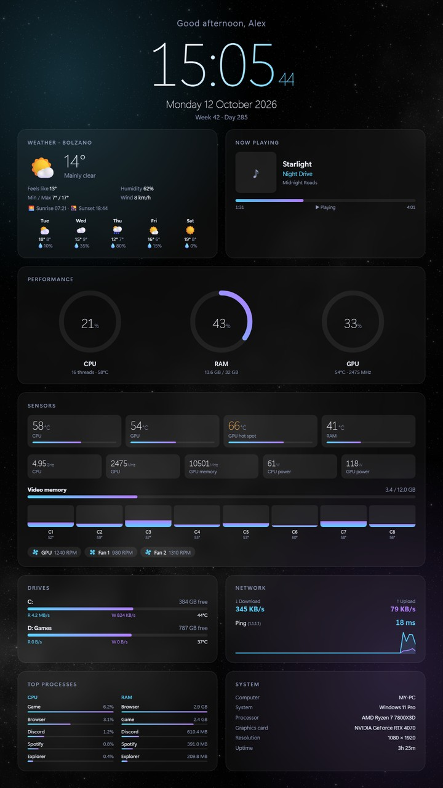

# Vertical System Clock

Sfondo per **Wallpaper Engine** con orologio, meteo, musica, sensori e informazioni di sistema, con la Via Lattea di sfondo. Pensato per i monitor verticali, funziona anche in orizzontale.

A **Wallpaper Engine** wallpaper with clock, weather, music, sensors and system info over a Milky Way background. Designed for vertical monitors, works horizontally too.

[🇮🇹 Italiano](#italiano) · [🇬🇧 English](#english)

---

## Italiano

### Cosa funziona subito
Abbonandoti allo sfondo sul Workshop funzionano subito: orologio digitale e analogico, data, **meteo** (scrivi la città nel pannello), **musica in riproduzione** (Spotify e altri), barre audio e la Via Lattea di sfondo.

### Dati di sistema: l'helper
Gli sfondi di Wallpaper Engine non possono leggere CPU, RAM, dischi e rete. Per questo serve il piccolo **helper** di questo repository:

1. Scarica il repository: **Code → Download ZIP**, poi estrai lo ZIP.
2. Apri la cartella `helper` e fai doppio clic su **`install.cmd`**.
3. Fatto: l'helper parte subito e a ogni accesso a Windows.

Per rimuoverlo: doppio clic su **`uninstall.cmd`**.

### Temperature, ventole e frequenze (facoltativo)
Servono a **LibreHardwareMonitor** (gratuito, open source):

1. Installalo da [GitHub](https://github.com/LibreHardwareMonitor/LibreHardwareMonitor/releases) oppure con `winget install LibreHardwareMonitor.LibreHardwareMonitor`.
2. Avvialo **come amministratore**.
3. Nel menu **Options** attiva **Remote Web Server** (porta 8085) e **Run On Windows Startup**.

### Privacy
- L'helper risponde **solo a questo PC** (`127.0.0.1:47811`): dalla rete non è raggiungibile.
- Non invia dati da nessuna parte. L'unica richiesta esterna è un ping a `1.1.1.1` per misurare la latenza.
- Il meteo usa [Open-Meteo](https://open-meteo.com/) (gratuito, senza account): riceve solo la città che scrivi.
- Il codice è tutto qui, leggibile: `helper/sysinfo.ps1`.

---

## English

### Works out of the box
After subscribing on the Workshop you get: digital and analog clock, date, **weather** (type your city in the panel), **now playing** (Spotify and others), audio bars and the Milky Way background.

### System data: the helper
Wallpaper Engine wallpapers can't read CPU, RAM, drives and network. That's what the small **helper** in this repository is for:

1. Download the repository: **Code → Download ZIP**, then extract it.
2. Open the `helper` folder and double-click **`install.cmd`**.
3. Done: the helper starts now and at every Windows sign-in.

To remove it: double-click **`uninstall.cmd`**.

### Temperatures, fans and clocks (optional)
These need **LibreHardwareMonitor** (free, open source):

1. Install it from [GitHub](https://github.com/LibreHardwareMonitor/LibreHardwareMonitor/releases) or with `winget install LibreHardwareMonitor.LibreHardwareMonitor`.
2. Run it **as administrator**.
3. In the **Options** menu enable **Remote Web Server** (port 8085) and **Run On Windows Startup**.

### Privacy
- The helper answers **only this PC** (`127.0.0.1:47811`): it can't be reached from the network.
- It sends no data anywhere. The only outgoing request is a ping to `1.1.1.1` to measure latency.
- Weather comes from [Open-Meteo](https://open-meteo.com/) (free, no account): it only receives the city you type.
- All the code is here and readable: `helper/sysinfo.ps1`.

---

## Contenuto / Contents

| Cartella / Folder | |
|---|---|
| `helper/` | `sysinfo.ps1` (helper), `install.cmd`, `uninstall.cmd` |
| `wallpaper/` | Sorgente dello sfondo / wallpaper source (`index.html`, `project.json`, `build_project.py`) |

Licenza / License: MIT.
